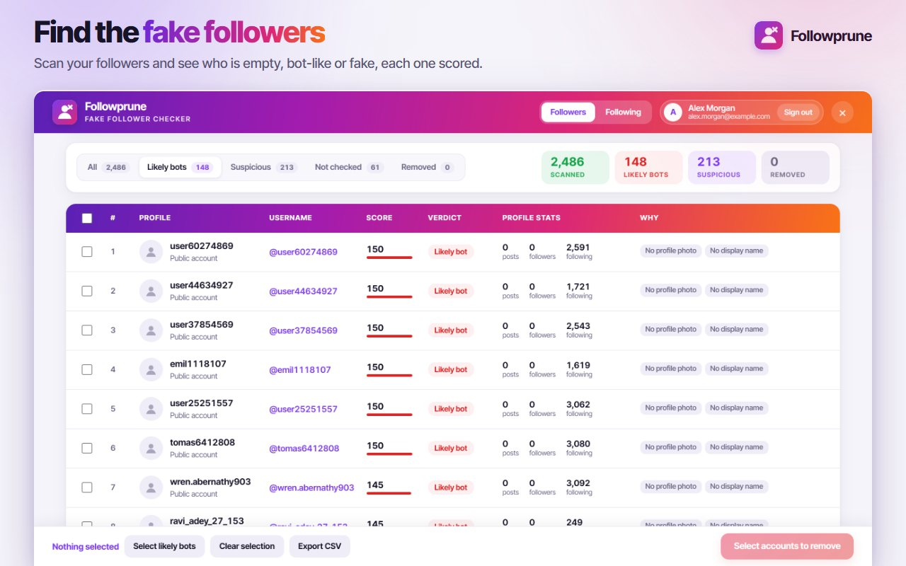
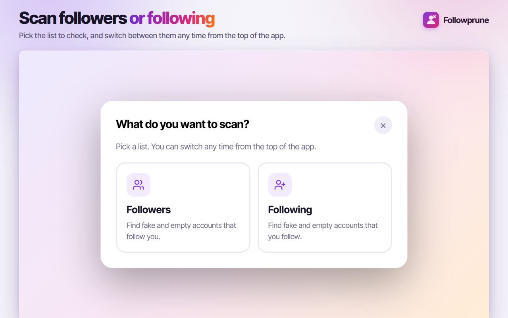
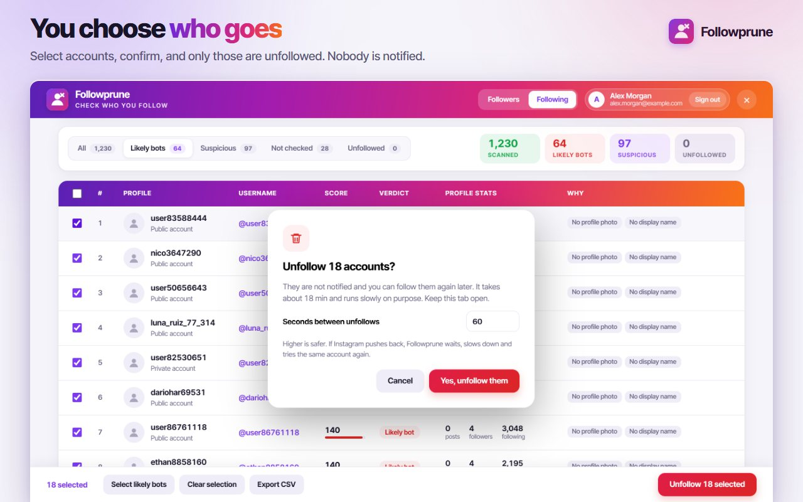
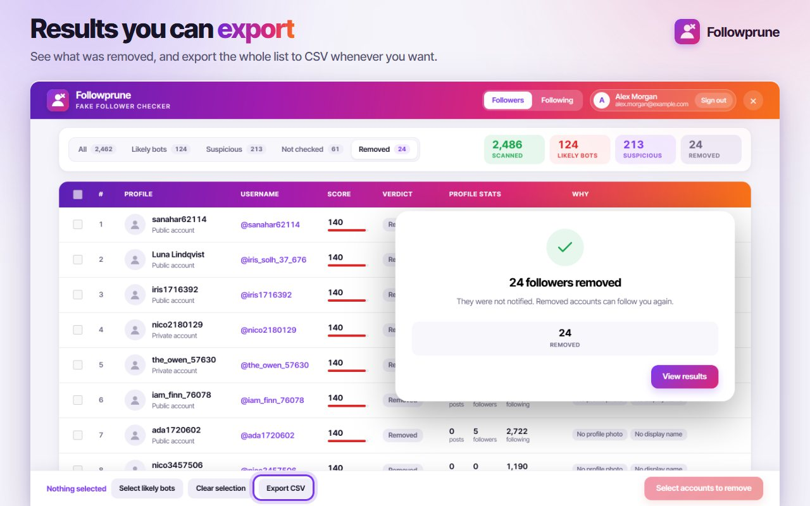

# Followprune: Fake Follower Checker and Bulk Remover for Instagram

Followprune is a Chrome extension that scans your Instagram followers, or the accounts you follow, flags the fake and empty ones with a score, and lets you remove or unfollow the ones you choose in one run. It works in the browser you already use and never asks for your Instagram password.

[Chrome Web Store](https://chromewebstore.google.com/detail/followprune-fake-follower/jbkmohlkhlococjmccmnjpepafalppgi?utm_source=github&utm_medium=readme&utm_campaign=followprune) | [Full guide and FAQ](https://www.addonschrome.com/extensions/followprune-fake-follower-checker-for-instagram.html?utm_source=github&utm_medium=readme&utm_campaign=followprune) | [Video demo](https://www.youtube.com/watch?v=2ba_Hc8ZwUM)

This repository is the public home for Followprune documentation, release notes and the issue tracker. The extension itself is distributed through the Chrome Web Store.

## Features

- **Followers or following:** scan your followers to remove fake ones, or the accounts you follow to unfollow in bulk. Each list keeps its own saved scan.
- **Fake and empty account score:** signals such as no profile picture, no display name, a username made of long numbers, no posts and an odd followers-to-following balance. A score is a strong hint, not proof.
- **Optional profile check:** open each suspicious profile to confirm with the post count and follower counts. Accounts with real activity move down the list.
- **Review before removing:** tabs for All, Likely bots, Suspicious, Not checked and Removed, with every profile picture and reason. Export the list as CSV before you remove anything.
- **Every removal confirmed:** an account counts as removed only when Instagram's own answer says so, and the first removal of every run is double-checked.
- **You set the pace:** choose the seconds between two removals. If Instagram pushes back, Followprune waits, slows down and retries, then stops with a clear message if it keeps refusing.
- **Pause, resume, rescan:** scans and results are saved; a stopped scan continues where it left off. "Scan for new followers" reads only your newest ones.
- **50+ languages.**

## How to use

1. Log in to instagram.com in Chrome, click the Followprune button on the right edge of the page and sign in with your Google account.
2. Pick your followers or the accounts you follow and press Scan. Nothing is removed at this stage.
3. Review the list: use the Likely bots and Suspicious tabs, run the optional profile check, and untick anyone you want to keep.
4. Choose the seconds between removals, confirm once, and Followprune removes the selected accounts one by one. Pause, resume or stop at any moment.

## Good to know

- Removing a follower or unfollowing does not send a notification. A removed follower can follow you again.
- Instagram limits how fast lists can be read and accounts removed, and on large accounts it can stop a list early. Followprune keeps what it already read and continues later.
- It works on instagram.com in Chrome on a computer, not in the Instagram app.

## Privacy

Followprune works through the Instagram session already open in your browser. It never asks for your Instagram password, and the lists are read on your device and never sent to a server of ours.

## Screenshots

## Support

Found a bug or have a feature request? [Open an issue](../../issues).

## Disclaimer

Followprune is an independent tool and is not affiliated with, endorsed by or sponsored by Instagram or Meta. Instagram is a trademark of its respective owner. Use a safe pace between removals.

Built and maintained by [Addons Chrome](https://www.addonschrome.com/?utm_source=github&utm_medium=readme&utm_campaign=followprune).
